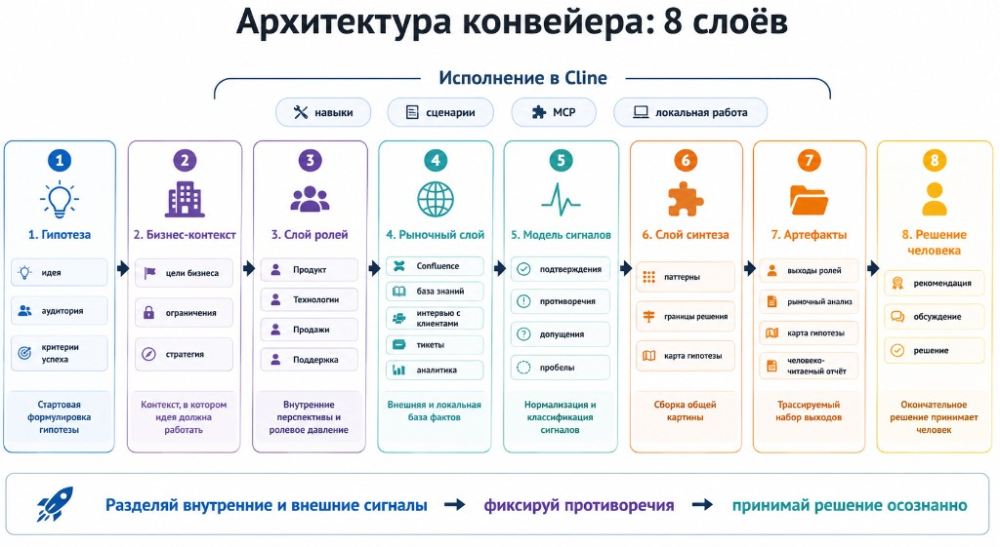
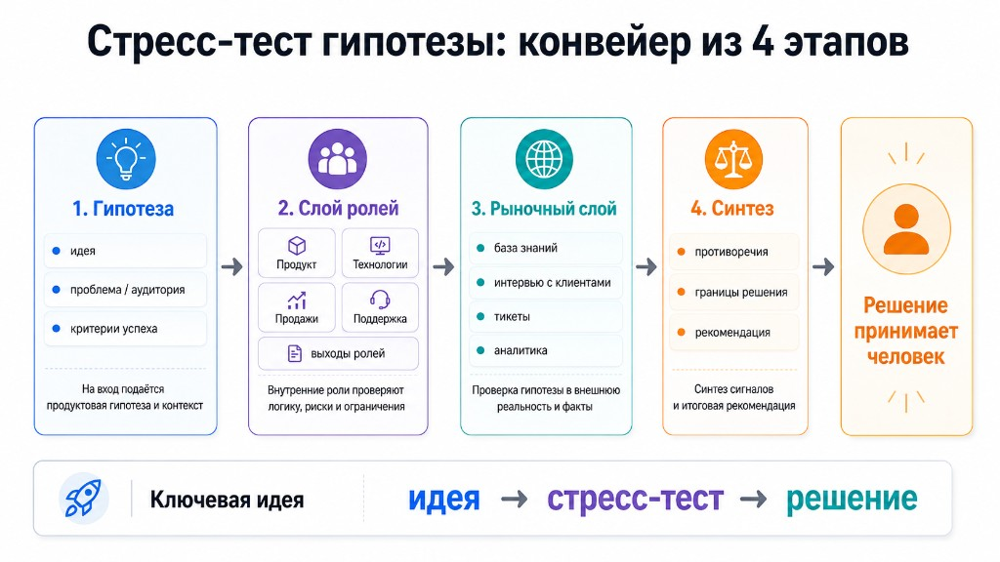
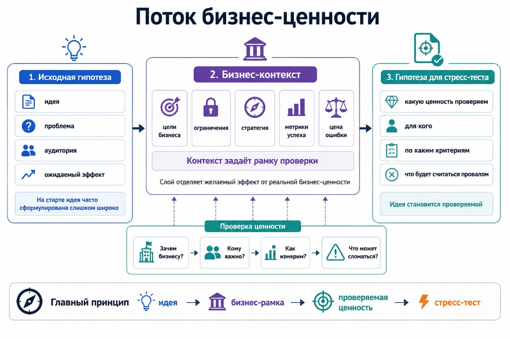
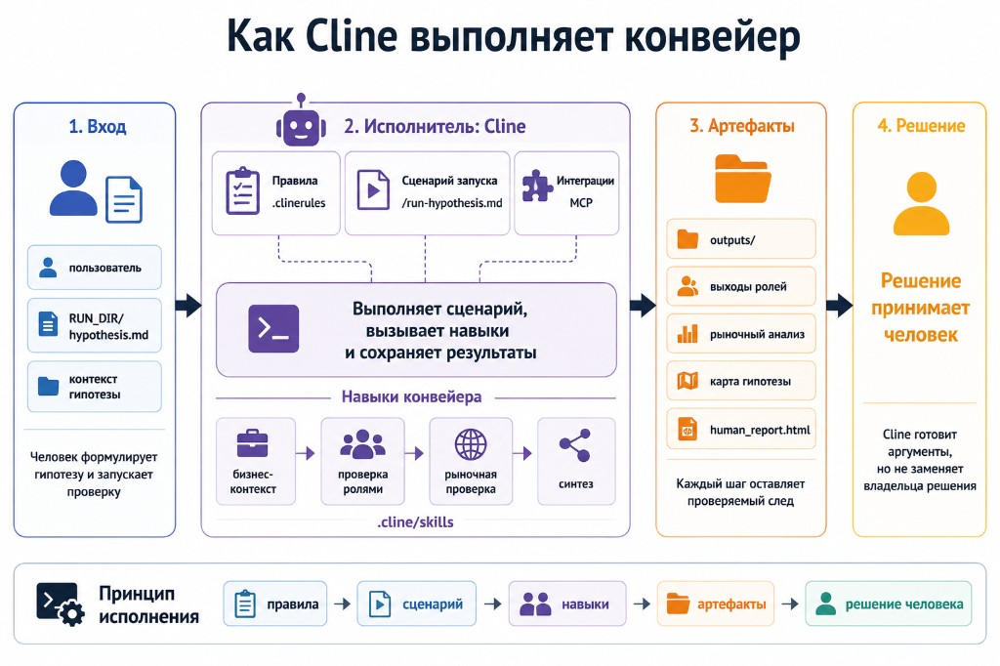
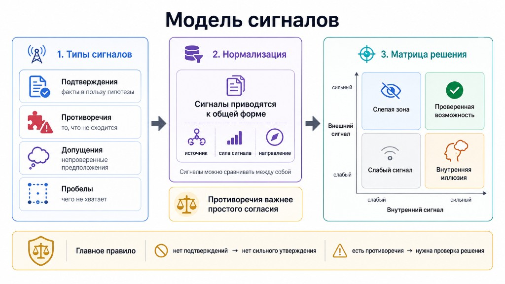
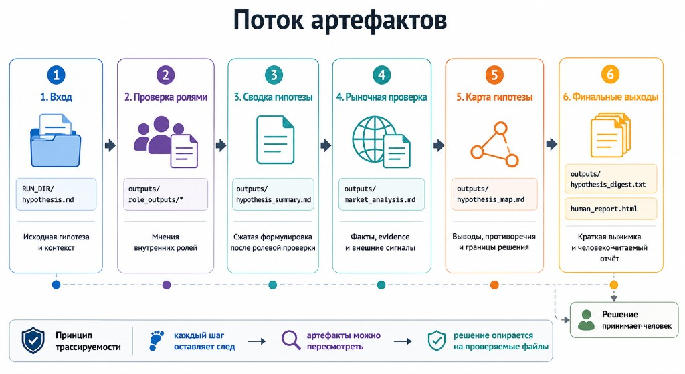
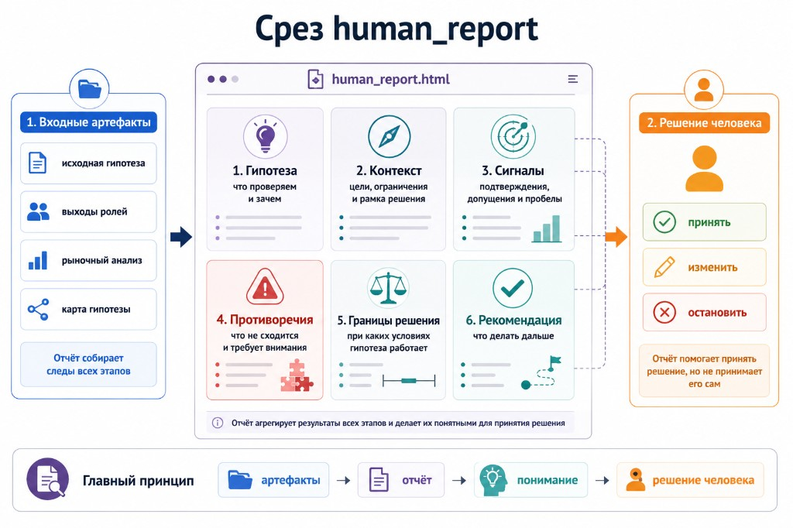
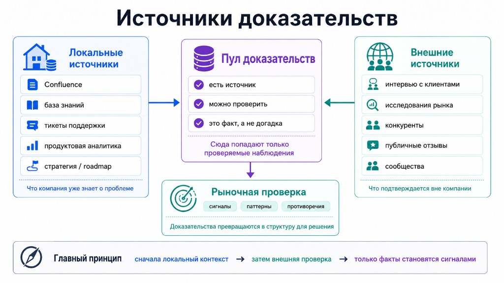

# 🧠 Hypothesis Stress Test

<p align="center">
  <sub>Версия фреймворка <b>2.7.0</b> · <a href="./CHANGELOG.md">Changelog</a></sub>
</p>

<p align="center">
  <b>Проверяйте гипотезы развития цифровых продуктов и сервисного бизнеса до вложения ресурсов.</b>
</p>

<p align="center">
  Слоистый фреймворк для продуктовых решений — запуск в VS Code через <a href="https://cline.bot/">Cline</a>, skills и Confluence MCP.
</p>

<p align="center">
  <a href="./implementations/quick-start.md"><b>Быстрый старт</b></a>
  ·
  <a href="./playbooks/run-hypothesis.md"><b>Playbook</b></a>
  ·
  <a href="./implementations/README.md"><b>Документация</b></a>
  ·
  <a href="./examples/example-001/"><b>Пример</b></a>
  ·
  <a href="./architecture/overview.md"><b>Архитектура</b></a>
  ·
  <a href="./roadmap/README.md"><b>Roadmap</b></a>
  ·
  <a href="./CHANGELOG.md"><b>Changelog</b></a>
</p>

<p align="center">
  
</p>

<p align="center">
  <a href="./assets/ru/architecture-overview.png">Открыть диаграмму</a>
</p>

---

## Что входит в HST

| Компонент | Что делает | Установка и обновление |
|---|---|---|
| Фреймворк и Cline | Skills, правила, слои анализа, проверки и отчёт; Cline выполняет исследование | ZIP + `setup_workspace.py`; затем `.hst/update.py` для вложенной установки |
| HTML-прогресс | Показывает этапы, ожидания, ошибки и историю источников в браузере | Входит во фреймворк; запускается при подготовке прогона |
| **HST · Прогресс** (Python, Rich/Click) | Показывает явно активированный прогон в отдельном терминале VS Code | Опция `--terminal` установщика; обновляется вместе с фреймворком |
| **Bubble Tea** (`hst-tui.exe`, Go) | Настройка гипотезы/источников до создания папки, запуск через Cline, ответы на вопросы, журнал | EXE + локальный HST Bridge для VS Code; однократный `--install`. Готовые сборки из Actions, общий обновлятор пока **не устанавливает EXE** |

HTML и Python-просмотр читают состояние прогона. Bubble Tea передаёт настройки и запрос запуска в Cline через локальный модуль VS Code, затем показывает подтверждение исполнителя и журнал. Исследование выполняет Cline. Исходники Bubble Tea находятся в этом же репозитории: [prototypes/bubbletea](prototypes/bubbletea/README.md).

---

## Зачем это нужно

Большинство продуктовых команд терпят неудачу не из-за отсутствия идей.

А потому что они:

* проверяют гипотезы слишком поздно
* полагаются на интуицию
* смешивают предположения с реальностью
* избегают противоречий

Этот фреймворк помогает ответить на один вопрос:

> **Стоит ли вообще реализовывать эту идею?**

---

## Ключевая идея

Не используйте LLM для генерации ещё большего количества идей.

Используйте его, чтобы **нагружать и проверять** уже существующие.

```text
идея → стресс-тест → решение
```

<p align="center">
  
</p>

---

## Как это работает

Независимые слои анализа, Customer Discovery Planning, обязательный Decision Review, Human Report и финальное решение человека. В `.cline/skills/` — **14 skills**: 10 фазовых, два навыка запуска (`hst-start`, `hst-run`), внешнее исследование и редактура текста.

| Фаза | Skill | Результат |
|------|-------|-----------|
| **Intake** (chat-first) | `conversational-hypothesis-intake` | draft карточки и `input/hypothesis.md` |
| **Validate** | `hypothesis-input-validation` | готовый `input/hypothesis.md` |
| **Facilitator** (Roles / stress test) | `hypothesis-facilitator` | `role_outputs/*`, `hypothesis_summary.md`, `validation_questions.md` |
| **Local Evidence Discovery** | `local-knowledge-retrieval` | `discovery_preview.md`, `evidence_inventory.md` |
| **Business Context** (ценность и стратегия) | `business-context-value-check` + `external-business-research` | бизнес-контекст или явный gap; `external_research.md` |
| **Market** (market reality check) | `hypothesis-market-layer` | `market_analysis.md` |
| **Synthesis** (столкновение сигналов) | `hypothesis-synthesis` | `hypothesis_map.md`, `hypothesis_digest.txt` |
| **Customer Discovery Planning** | `customer-discovery-planning` | `customer_discovery_plan.md` |
| **Decision Review** | `hypothesis-decision-review` | `decision_review.md` |
| **Human Report** | `human-report-export` | `human_report.html` |
| **Решение человека** | — | продуктовое действие или сервисный пилот / предложение / компетенции / продажи |

Вне пайплайна гипотез:

| Skill | Назначение |
|-------|------------|
| `russian-humanizer` | редактура русского текста; см. [humanizer/README.md](./humanizer/README.md) |

<p align="center">
  
</p>

Слой Business Context отделяет желаемый эффект от реальной бизнес-ценности — подробнее: [layers/business-context-layer.md](./layers/business-context-layer.md)

Полный прогон: попросите Cline использовать **`hst-start`** для новой гипотезы или **`hst-run`** для существующей. Навыки работают без workflows. Старые команды сохранены как совместимые входы.

Старый chat-first alias: `/run-hypothesis-conversational.md`

Полный прогон (file-first): `/run-hypothesis.md`

По фазам:

```text
/validate-hypothesis-input.md
/run-facilitator.md
/run-knowledge-retrieval.md
/run-business-context-value-check.md
/run-market-layer.md
/run-synthesis.md
/run-customer-discovery-planning.md
/run-decision-review.md
/run-human-report-export.md
```

Указывайте `RUN_DIR` в сообщении Cline, например: `RUN_DIR: runs/HYP-2026-06-22-001`

---

## Реализация на Cline

<p align="center">
  
</p>

| Компонент | Расположение | Назначение |
|-----------|--------------|------------|
| **Rules** | `.clinerules/` | Постоянные инварианты фреймворка |
| **Skills** | `.cline/skills/` | Выполнение фаз по запросу |
| **Workflows** | `.clinerules/workflows/` | Slash-команды |
| **Confluence MCP** | MCP config | Основной источник local signals |

Настройка: [implementations/cline-setup.md](./implementations/cline-setup.md)

Confluence MCP: [implementations/confluence-mcp.md](./implementations/confluence-mcp.md)

Контракт: [implementations/cline-contract.md](./implementations/cline-contract.md)

---

## Модель принятия решений

<p align="center">
  
</p>

Synthesis (`hypothesis-synthesis`) классифицирует столкновение сигналов:

* **Validated Opportunity** — внутренние и внешние сигналы совпадают
* **Internal Illusion** — внутри всё выглядит логично, но рынок не подтверждает
* **Blind Spot** — рынок показывает возможность, но внутри её не видят
* **Weak Signal** — слабые сигналы со всех сторон
* **Local Optimization Trap** — боль подтверждена, но стратегической ценности нет

---

## Поток артефактов

<p align="center">
  
</p>

Каждый запуск создаёт трассируемую цепочку:

```text
RUN_DIR/
  input/
    hypothesis.md
    attachments/
  run.md
  run_config.json             # настройки текущего прогона и выбор источников
  outputs/
    role_outputs/*
    hypothesis_summary.md
    validation_questions.md
    discovery_preview.md
    evidence_inventory.md
    business_context_analysis.md
    missing_business_context.md  # только при отсутствии контекста
    market_analysis.md
    hypothesis_map.md
    hypothesis_digest.txt
    customer_discovery_plan.md
    decision_review.md
    human_report.html
    startup_events.jsonl      # реальная история подготовки до создания папки (новые chat-first прогоны)
    tui_launch.json           # конфигурация, отправленная из TUI (для TUI-запуска)
    tui_control.json          # подтверждение исполнителя и состояние вопроса
    tui_events.jsonl          # история запуска и ответов
    source_selection.md       # история выбора каналов
    source_snapshot.json      # исходные фрагменты и привязки
    claim_ledger.json          # утверждения и их основания
    quality_review.json        # проверка выводов и ограничений
    pipeline_events.jsonl      # журнал фаз и обращений к источникам
    progress.json
    progress.html
    run_validation.json        # последний результат проверки
    validation_history.jsonl   # история попыток, включая FAIL
    *.marker
```

Язык артефактов совпадает с языком `input/hypothesis.md`.

---

## Human Decision Report

<p align="center">
  
</p>

`human_report.html` агрегирует артефакты всех этапов в decision-facing отчёт — решение принимает человек. Пример: [examples/example-002/outputs/human_report.html](./examples/example-002/outputs/human_report.html)

---

## Источники доказательств

<p align="center">
  
</p>

До сбора данных пользователь подтверждает три канала: **локальная база, Confluence и интернет**, а при необходимости — конкретные папки. Можно отключить любой канал; ограничения будут отражены в результатах. При продолжении сохраняется выбор этого прогона.

Выбор канала и результат обращения показываются отдельно: «включён» ещё не означает «прочитан» или «использован». Журнал различает отказ, ожидание разрешения, ошибку доступа, пустую выдачу, чтение и использование. История старых прогонов автоматически не дописывается.

Локальные и внешние источники сходятся в пул проверяемых наблюдений. Синтетические ответы ролевых аватаров служат для проверки предположений и подготовки вопросов; они не доказывают спрос. Без эмпирических данных вывод может остаться `unknown`, а следующий шаг — дополнительное исследование.

---

## Быстрый старт (Cline)

Полный гайд: **[implementations/quick-start.md](./implementations/quick-start.md)**

Кратко:

1. Распакуйте фреймворк в свою базу знаний или откройте его отдельно; материалы оставьте на своих местах.
2. Установите Cline и настройте модель.
3. Для вложенного фреймворка запустите `python <папка-фреймворка>/scripts/setup_workspace.py --workspace .` и затем `--apply`, если нет конфликтов.
4. Установите `requirements-evidence.txt` для PDF/DOCX/XLSX и проверьте Rules/Skills по [инструкции](implementations/quick-start.md).
5. Напишите Cline: «Используй hst-start для полного стресс-теста», затем идею и пути к важным материалам.
6. Проверьте карточку и полноту источников. Для готовой гипотезы карточка и предлагаемая папка подтверждаются одним ответом. Подготовка до создания папки видна в терминале; после валидации доступен локальный HTML. Итог — `outputs/human_report.html`.

Confluence необязателен. Интернет-исследование входит в полный прогон, если явно не исключено. Недоступность источников и ожидание разрешений показываются отдельно.

Операционная документация: [implementations/README.md](./implementations/README.md)

Ручной режим: [playbooks/run-hypothesis.md](./playbooks/run-hypothesis.md)

---

## Обновление существующей установки

Для ZIP-фреймворка внутри базы знаний выполняйте **из корня базы** (например, DataB), между прогонами:

```powershell
python .\.hst\update.py --workspace . --apply
```

Команда скачивает текущий `main`, сохраняет резервную копию в `.hst/updates/`, обновляет фреймворк, правила/skills в корне базы и установленный Python-просмотр. Прогоны в `DataB/runs` остаются на месте. Чтобы сначала посмотреть план обновления, уберите `--apply`. После обновления перезапустите **HST · Прогресс** и начните новый чат Cline.

Если `.hst/update.py` ещё нет, используйте скрипт из установленной папки:

```powershell
python .\hypothesis-stress-test-main\scripts\update_workspace.py --workspace . --apply
```

Если нет и этого скрипта, в [быстром старте](implementations/quick-start.md#если-hstupdatepy-не-найден) приведён однократный запуск обновлятора с GitHub. Для Git-клона используется `git pull`; обновление корневых правил вложенной установки выполняется через `setup_workspace.py` по [инструкции](implementations/quick-start.md).

**Bubble Tea пока обновляется отдельно:** исходники приходят с репозиторием, но готовый `hst-tui.exe` общий обновлятор не скачивает и не заменяет. Инструкция — ниже.

### Если Windows блокирует обновление или EXE

`WinError 5` при переносе папки может означать блокировку процессом или проблему с правами. Даже после закрытия VS Code может остаться Python-процесс HTML-просмотра. Аналогично запущенный `hst-tui.exe` может мешать замене своего файла.

1. Завершите работающий прогон и закройте просмотры: **Q** в Bubble Tea, **Ctrl+C** в терминале сервера. Перейдите из папки фреймворка в корень DataB.
2. Если блокировка осталась, откройте **Win+R → `resmon` → ЦП → Связанные дескрипторы** и найдите `hypothesis-stress-test-main` или `hst-tui.exe`.
3. Проверьте имя, PID и назначение найденного процесса; закройте именно его. Если нужен PowerShell, используйте `Stop-Process -Id <PID>` с фактическим PID, а затем повторите обновление.

Если дескриптор не найден или завершение процесса не помогло, причина ещё не установлена: сохраните полный текст ошибки. Не удаляйте папку фреймворка или резервные копии ради повторной попытки. Команды диагностики ничего не исправляют в правах доступа автоматически.

---

## Подготовка до создания папки прогона

Новый chat-first запуск сначала публикует состояние подготовки в `.hst`, ещё до чтения профиля и составления карточки. **HST · Прогресс** показывает подготовку/ожидание ответа; Bubble Tea показывает отдельную строку на всех экранах, включая список старых прогонов. Фиктивный HYP-прогон не создаётся и этапы не объявляются завершёнными.

После подтверждения карточки и новой папки история переносится в `outputs/startup_events.jsonl`, а терминал показывает проверку входа до запуска анализа. Готовые поля не запрашиваются повторно; для полного входа карточка и папка подтверждаются одним ответом. Первый участок внутренних размышлений LLM до вызова инструмента остаётся вне журнала; это не измерение чистой скорости модели.

Новое состояние появится только в новых запусках с обновлёнными правилами. Уже работающий чат сам на них не переключится. Для отображения ранней подготовки в Bubble Tea нужна сборка EXE версии 2.7.0; Python-просмотр обновляется обычной командой.

## Терминальное управление Bubble Tea

Нажмите **N** в TUI: гипотеза → профиль и контекст → источники и папки → проверка → **Запустить новую задачу Cline**. Папка создаётся после запуска; параметры источников применяются до анализа. Интерфейс различает сохранение настроек, передачу в Cline и подтверждение, полученное из самой задачи.

Нужен локальный **HST Pipeline Bridge** для VS Code: он использует публичный API уже установленного Cline, сохраняя его модель, доступы и разрешения. После скачивания EXE из [Actions](https://github.com/SergeyNash/hypothesis-stress-test/actions/workflows/bubbletea-prototype.yml) выполните из распакованной папки:

```powershell
.\hst-tui.exe --workspace "C:\Users\SSiniakov\Documents\DataB" --install
```

Перезагрузите окно VS Code — **HST · Управление** откроется автоматически. У прежнего Python-монитора отключается автозапуск; он остаётся доступен вручную. Вопросы HST приходят в TUI: можно выбрать вариант или ввести ответ. В прошлых прогонах настройки недоступны для редактирования. Нативные подтверждения инструментов остаются в Cline.

Одновременно поддерживается один управляемый прогон в одной открытой папке VS Code. Пока он работает, не переключайте Cline на другую задачу: публичный API адресует текущую задачу. При недоступной связи не показывается фиктивный успех. Закрытие TUI не останавливает Cline; запрос и вопрос восстанавливаются при открытии.

Готовый EXE и VSIX собираются в GitHub Actions; `--version` показывает номер сборки. Общий обновлятор пока не заменяет EXE. Установка, клавиши, диагностика и ограничения: [README терминального интерфейса](prototypes/bubbletea/README.md).

---

## Пример

```text
examples/example-001/    # AppSec — эталонный demo
examples/example-002/    # HR Tech — универсальность подхода
humanizer/               # навыки редактуры русского (adapters + USAGE)
```

Chat-first walkthrough: [examples/chat-first-run.md](./examples/chat-first-run.md)

**example-001:** AppSec — reframe из risk reduction в operational efficiency; **Proceed with Validation**. Артефакты на **русском**.

**example-002:** HR Tech — reframe из AI auto-ranking в governed recruiter assist. Артефакты на **русском**.

Редактура русского текста: [humanizer/README.md](./humanizer/README.md) — skill `russian-humanizer` + project voice adapters

---

## Фреймворк vs Инструменты

```text
Фреймворк  → как думать (слои, контракты, модель решений)
Cline      → как запускать (rules, skills, workflows, MCP)
```

Фреймворк не привязан к инструменту. Cline — основная поддерживаемая реализация. Возможны ручной режим и API (см. [architecture/implementations.md](./architecture/implementations.md)).

---

## Структура репозитория

```text
.clinerules/       правила и workflows Cline
.cline/skills/     skills по фазам (+ russian-humanizer для редактуры текста)
layers/            логика анализа
templates/         шаблоны для ручного режима
playbooks/         сценарии
examples/          примеры
humanizer/         adapters и USAGE для writing skills (core в .cline/skills/russian-humanizer/references/)
runs/              прогоны гипотез (в KB workspace)
knowledge-base/    гайд по Confluence / local signals
architecture/      устройство системы
implementations/   установка, обновление, Cline, Confluence MCP, контроль качества
scripts/           контроллер фаз, проверки, readers, HTML/Python-просмотр, установщик
prototypes/bubbletea/ отдельный Go-прототип hst-tui
.github/workflows/ проверки контрактов и сборка прототипа
roadmap/           дорожная карта
assets/ru/         диаграммы (PNG)
assets/            legacy SVG и прочее
CHANGELOG.md       история версий фреймворка
VERSION            текущая версия фреймворка
```

---

## Принципы

* разделяй внутренние и внешние сигналы
* сначала local evidence inventory, затем Confluence как внутренний wiki-канал
* нет данных → нет утверждения
* противоречия важнее согласия
* оспаривай выводы перед backlog
* решение принимает человек
* плохие идеи должны умирать рано

---

## Чем это не является

* генератором идей
* заменой реальным пользователям и интервью
* substitute для полноценного market research
* автономным decision-maker

---

<p align="center">
  <b>Проверьте идею до того, как начнёте её делать.</b>
</p>

## Сервисный бизнес (v2.5)

Профиль service_business расширяет HST на новые услуги, предложения, коммерческие модели, способы оказания, улучшения и продления. Он разделяет ценность заказчику, путь покупки, исполнимость и экономику поставщика. Тот же порядок фаз и артефакты; без выбора профиля действует digital_product.

- [Профили и выбор режима](profiles/README.md)
- [Контракт сервисного профиля](profiles/service-business.md)
- [Гипотеза развития: проактивная поддержка с ИИ](examples/example-005/run.md) — синтетический пример, не доказательство спроса
- [Перечень изменений и статусы](roadmap/service-business.md)
- [Локальные PDF/DOCX/XLSX readers](implementations/evidence-extraction.md)

Проверка: python scripts/validate_runs.py --examples; python -m unittest discover -s tests -v. Архитектурные PNG иллюстрируют общий замысел; точный порядок фаз и профильные проверки задаёт текстовый контракт.

## Доработка старта и полноты исследования

[План, диагностика и статусы](roadmap/onboarding-evidence.md). Живой прогресс: `scripts/run_progress.py`, настройка рабочего пространства: `scripts/setup_workspace.py`. Новые сценарии требуют повторной синхронизации `.cline` и `.clinerules` в корне вашей KB; одного обновления вложенной папки недостаточно. Старые примеры сохранены как исторические результаты, не как демонстрация новых обращений к источникам.

### Проверка своего прогона и значение PASS

```shell
python scripts/validate_runs.py --run-dir /path/to/runs/HYP-YYYY-MM-DD-001 --json
```

Указывайте фактическую папку прогона. Вывод содержит `scope`, абсолютный `target`, PASS/FAIL и ошибки. `--examples` проверяет только примеры репозитория; запуск без выбора цели отклоняется. PASS означает прохождение перечисленных проверок структуры и, для новых прогонов, согласованности заявленного аудита. Это не подтверждение спроса, достоверности первоисточников или полноты исследования.

Новые прогоны запускаются через `scripts/run_control.py prepare --run-dir <RUN_DIR> --mode full`: появляется проверенная HTTP-ссылка на прогресс. После отчёта `finish --run-dir <RUN_DIR>` проверяет именно этот прогон, сохраняет `outputs/run_validation.json` и разрешает завершение только после PASS. Подробности: [контроль качества](implementations/run-quality.md). Обычные переходы между слоями полного прогона не требуют повторного согласия; перед глубоким анализом таблиц пользователь выбирает быстрый просмотр, подробный анализ или пропуск.

### Привязка к исходным данным (audit_version 2)

Новые прогоны сохраняют `outputs/source_snapshot.json`: исходные фрагменты с адресами, хешами файлов и ограничениями извлечения. Числа сверяются с исходной ячейкой/абзацем; отдельно проверяются периоды, разные знаменатели, повторы закупок, условия пилота и доказательства оплаты. Оригиналы должны оставаться доступны для повторной проверки. Снимок локального файла не удостоверяет истинность исследования или подлинность удалённой страницы.

В новых полных прогонах после подтверждения источников контроллер отмечает подготовку Facilitator, а после успешного `complete` — подготовку следующего нетронутого этапа, до генерации его файлов. `start` повторно не создаёт событие для уже работающего этапа; ошибки и ожидания требуют явного продолжения. Промежуточные проверки учитывают текущий и предыдущие слои, финальная — весь прогон.

Перед каждым слоем оркестратор использует `run_control.py start --run-dir <RUN_DIR> --phase <phase>`: viewer проверяется до фасилитатора. Если сервер недоступен, причина сообщается сразу. История всех проверок остаётся в `outputs/validation_history.jsonl`; последний PASS не стирает прошлые FAIL.

Старые прогоны сохраняют прежний уровень аудита. Диагностика по новым требованиям без изменения файлов:

```shell
python scripts/validate_runs.py --run-dir <RUN_DIR> --strict --json
```

Недостающие привязки в старом прогоне означают FAIL по новым требованиям. Это не повод автоматически переписать его историю. Для новых прогонов используйте обновлённые правила и шаблоны; подробный контракт — в [контроле качества](implementations/run-quality.md).

### Отдельный терминал VS Code с прогрессом

Опциональное подключение: `setup_workspace.py --workspace . --terminal --apply` (для обновления отличающихся файлов — также `--replace-framework-files`). Установщик создаёт изолированную среду Click/Rich и задачу **HST · Прогресс**, сохраняя другие задачи и комментарии в tasks.json.

В уже открытой базе один раз выберите **Терминал → Запустить задачу → HST · Прогресс**. Для последующих открытий разрешите автоматические задачи через штатный запрос VS Code. Экран ждёт новый прогон и подхватывает его после prepare; каждый раз вводить RUN_DIR не нужно. После завершения показывает итог проверки и ссылку на отчёт. Закрытие просмотра не останавливает Cline. [Подключение и восстановление](implementations/terminal-progress.md).
