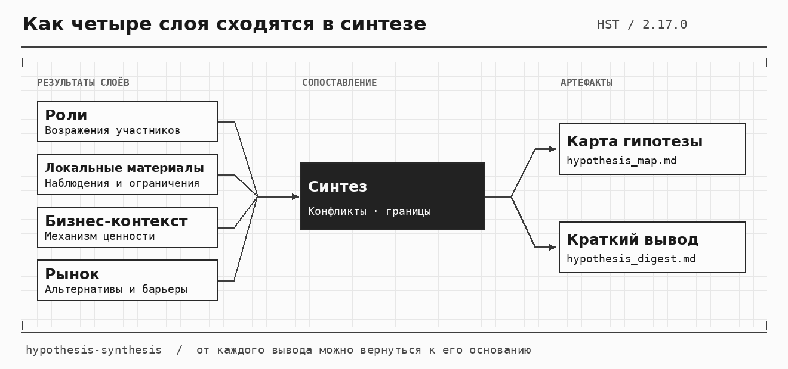
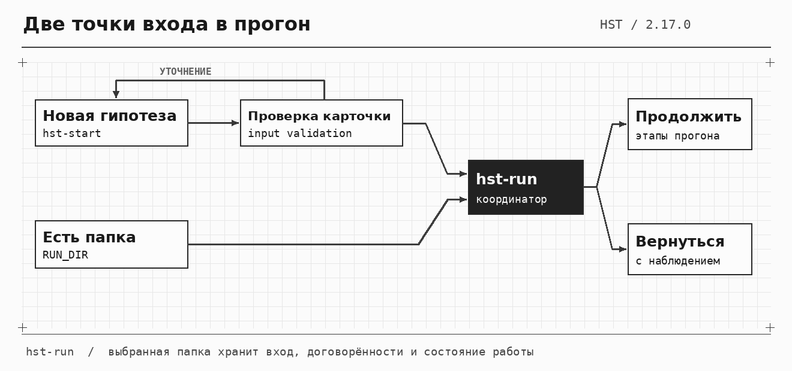
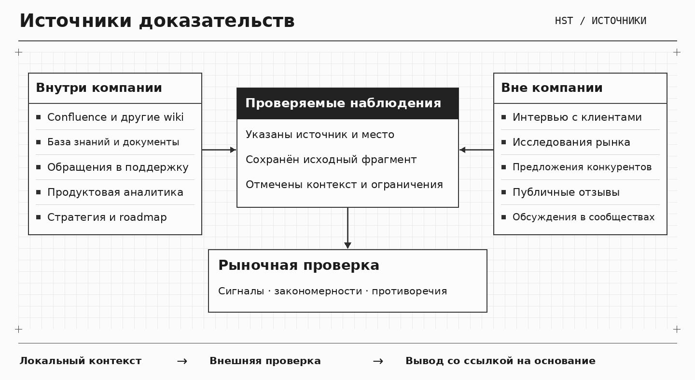
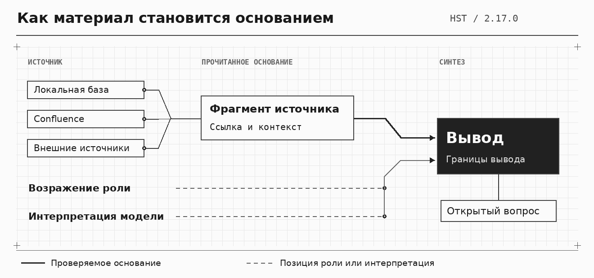
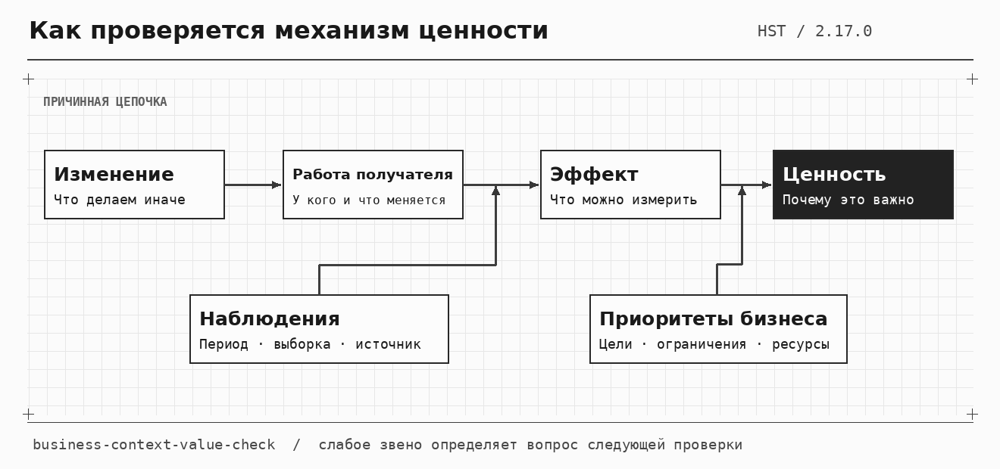
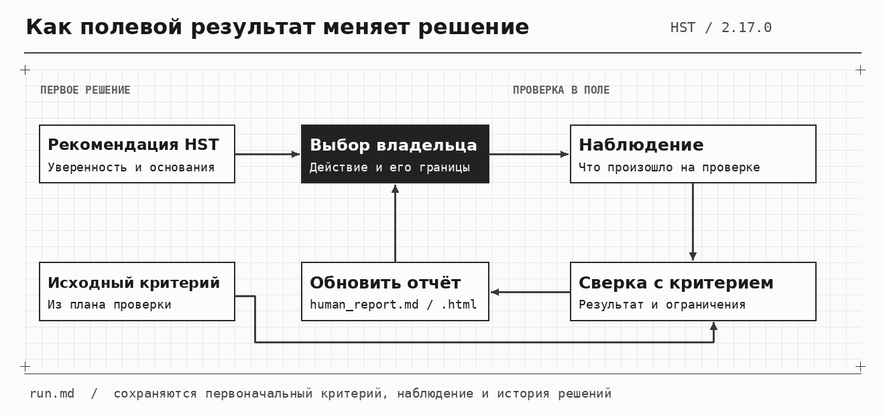

# Hypothesis Stress Test

Версия фреймворка <b>2.18.0</b>

**Как понять, стоит ли развивать гипотезу и что могло бы изменить ваше решение?**

Обычно у автора уже есть объяснение, почему идея должна сработать. HST помогает разобрать это объяснение по частям. Кому важно предлагаемое изменение? Что мы действительно наблюдали? За счёт чего должен возникнуть эффект? Где расходятся интересы участников, факты и ожидания бизнеса?

Hypothesis Stress Test — фреймворк для критического разбора продуктовых и сервисных гипотез с помощью языковой модели. Система сохраняет промежуточные результаты. От итоговой рекомендации можно вернуться к спорному тезису, открыть фрагмент источника и самому оценить, достаточно ли оснований для решения.

[Начать работу](implementations/quick-start.md) · [Каталог 14 skills](.cline/skills/README.md) · [Перейти к устройству отчёта](#8-что-видит-человек-и-как-вернуться-с-новыми-данными)

## 1. Из чего складывается стресс-тест

У каждого слоя свой предмет. Роли выявляют возможные возражения. Материалы позволяют проверить, что происходило в действительности. Бизнес-контекст объясняет, почему это может быть важно. Рынок показывает альтернативы и условия, в которых придётся действовать. Синтез связывает результаты, сохраняя происхождение каждого существенного вывода.



Ролевые возражения, локальные факты, бизнес-контекст и рынок сводятся в карту. На ней видно, какие части гипотезы выдержали проверку и где основания расходятся.

Стрелки к синтезу показывают, какие результаты он сопоставляет. Последовательность важна: роли успевают сформулировать сомнения до знакомства с выводами рынка, а рынок получает уже собранные основания и ограничения. Если несколько документов восходят к одному наблюдению, при синтезе оно учитывается один раз.

## 2. Как начинается и продолжается прогон



Для новой идеи hst-start помогает подготовить карточку. Если папка уже есть, hst-run продолжает работу с сохранёнными материалами.

| Skill | За что отвечает |
| --- | --- |
| `hst-start` | Принимает новую гипотезу, согласует профиль, участников, доступные источники и глубину. После разрешения на запуск создаёт папку, сохраняет исходную карточку и договорённости. |
| `conversational-hypothesis-intake` | Помогает оформить заметки или готовую формулировку. Вместе с автором уточняет аудиторию, предлагаемое изменение, ожидаемый результат и исходные основания. Автор видит, что предложено изменить. |
| `hypothesis-input-validation` | Проверяет смысл карточки: можно ли понять, у кого что изменится, как заметить эффект и при каком наблюдении гипотезу придётся пересмотреть. При существенном пробеле возвращает конкретный вопрос автору. |
| `hst-run` | Ведёт выбранную папку по этапам, сохраняет результаты и обращается к человеку в точках выбора. При возврате к завершённому разбору принимает новые наблюдения в контексте прежнего решения. |

**Профиль определяет вопросы разбора.** В продуктовом профиле важны пользователь, изменение поведения, эффект для продукта и решение о дальнейшей работе. В сервисном профиле система различает заказчика и поставщика, покупку и исполнение, внешнее обещание и внутреннее улучшение. Профиль меняет требования к основаниям внутри тех же восьми этапов.

## 3. Что происходит на каждом из восьми этапов

| Этап и skill | С чем работает | Что делает и что получает следующий этап |
| --- | --- | --- |
| **1. Ролевой стресс-тест** · `hypothesis-facilitator` | Карточка, контекст, выбранные перспективы | Отдельно разбирает интересы участников, причины отказа, альтернативы и условия пересмотра возражений. Сводит конфликты и формулирует вопросы, на которые предстоит искать фактические ответы. |
| **2. Локальные материалы** · `local-knowledge-retrieval` | Вопросы ролей и согласованная область базы знаний | Отбирает документы, показывает охват и предлагает добавить упущенное. Записывает прочитанные фрагменты, их происхождение и границы. На выходе видно, какие ролевые возражения уже можно проверить. |
| **3. Бизнес-контекст** · `business-context-value-check` | Карточка, тип гипотезы, локальные основания, доступные приоритеты | Восстанавливает связь между изменением в работе и ценностью для бизнеса. Выделяет слабое звено и условия получения эффекта. При отсутствии пригодного контекста фиксирует, какие выводы остаются открытыми. |
| **4. Рынок** · `hypothesis-market-layer` | Вопрос решения, реестр оснований, бизнес-контекст, уже выполненное внешнее исследование | Проверяет признаки потребности, существующие решения, альтернативы, путь покупки и барьеры перехода, когда они применимы. Передаёт в синтез рыночные выводы с источниками и фактическим покрытием каналов. |
| **5. Синтез** · `hypothesis-synthesis` | Исходная формулировка и сохранённые результаты предыдущих слоёв | Сопоставляет ожидания ролей с фактами, ценностью и рыночными условиями. Уточняет, какая часть гипотезы выдерживает разбор, где возникло противоречие и какое неизвестное сильнее всего влияет на выбор. |
| **6. План проверки** · `customer-discovery-planning` | Карта гипотезы и решающие неизвестные | Выбирает соразмерный способ проверки: интервью, наблюдение, разбор данных, эксперимент или ограниченный пилот. Фиксирует выборку, наблюдаемый результат, критерии и действия при положительном, отрицательном и неопределённом исходе. |
| **7. Критический разбор** · `hypothesis-decision-review` | Ключевые выводы, конкретные фрагменты источников и план | Проверяет, подтверждает ли фрагмент именно заявленный тезис. Проверяет развилки плана, включая пограничные значения и нехватку данных. Формулирует рекомендацию, уверенность и условия, способные изменить выбор. |
| **8. Итоговый отчёт** · `human-report-export` | Карточка, результаты этапов, рекомендация и решения в журнале прогона | Собирает две согласованные версии отчёта. Связывает вопросы владельца с основаниями, показывает контраргументы, ближайшую проверку, фактический охват и полный перечень материалов. |

Ещё два навыка подключаются по задаче. **`external-business-research`** вызывают из бизнес-контекста или рынка для согласованного внешнего вопроса. Оба слоя используют один результат исследования. **`russian-humanizer`** редактирует русский текст по отдельному запросу. Итого в каталоге **14 skills**: четыре для старта и управления, восемь этапных и два для отдельных задач. Смоделированные участники — перспективы внутри ролевого разбора. Их количество зависит от гипотезы.

## 4. Откуда берутся основания



Группы на схеме показывают происхождение сведений. Запись клиентского интервью может лежать в локальной базе. HST учитывает, кто сообщил сведения, где зафиксирован фрагмент и какую часть гипотезы он позволяет проверить.



Для вывода сохраняют конкретный фрагмент и его место в источнике. Рядом фиксируют, какую часть утверждения он поддерживает и что остаётся допущением.

| Канал в рыночном анализе | Что доступно для разбора | Как читать результат |
| --- | --- | --- |
| **Local KB** | Согласованные папки стратегии, исследований и развития, интервью, аналитика, обращения, договорные и операционные материалы. Markdown, PDF, Word и Excel — в пределах инструментов клиента. | Для использованного основания сохраняются путь, раздел, страница или лист и ячейка, короткая цитата либо наблюдение, период и выборка, когда они известны. |
| **Confluence** | Страницы корпоративной wiki через доступное подключение. | Прочитанная страница и поисковый фрагмент имеют разный статус. В отчёте виден фактический охват уникальных страниц. |
| **External** | Первичные публикации, оригинальные исследования, предложения поставщиков, закупки и результаты закупок. | Для тезиса важны дата, сегмент, прямота и независимость источника. Копия внешнего отчёта в локальной папке сохраняет внешнее происхождение. |
| **Inferred** | Интерпретация модели, связывающая доступные сведения. | У вывода должны быть видны исходные основания и оставшееся допущение. Интерпретация сама по себе не добавляет наблюдений. |

**Как ограничивается поиск.** Сначала система отбирает материалы под вопросы гипотезы. Перед объёмной обработкой таблицы или существенным расширением области человек выбирает глубину. Внешнему исследователю передаются конкретный вопрос, границы и уже известные основания. Бизнес-контекст и рынок делят один бюджет внешнего поиска. Когда получен ответ либо установлен пробел и понятно его влияние на решение, поиск заканчивается. Недоступный документ остаётся в ограничениях покрытия.

## 5. Как система разбирает бизнес-ценность



Между предлагаемым изменением и метрикой бизнеса есть промежуточные звенья. Для каждого нужно понять, чья работа изменится и каким наблюдением можно проверить эту связь.

Подтверждённая проблема — основание исследовать изменение. Для решения о вложениях предстоит понять, ведёт ли изменение к нужному результату и насколько он важен относительно других приоритетов. Если стратегия недоступна, соответствие приоритетам остаётся открытым. При этом операционные данные могут дать основания для других частей вывода.

**Для сервисной гипотезы** HST отдельно рассматривает четыре вопроса. Общая положительная оценка скрыла бы различия между ними.

| Что оценивается | Что нужно установить |
| --- | --- |
| Ценность для заказчика | Чья работа изменится, как проявится результат и на каких наблюдениях основано ожидание эффекта. |
| Путь покупки | Кто получает пользу, кто согласует затраты, кто платит и какие свидетельства есть о готовности купить или продлить. |
| Исполнимость | Каковы границы обязательств, достаточно ли компетенций, доступов, мощности и возможностей эскалации. |
| Экономика поставщика | За какой период и на какую единицу считаются выручка, трудозатраты, внешние расходы и маржинальный доход. |

Каждый применимый вывод может получить поддержку, остаться условным или неизвестным, встретить опровергающие данные. Для внутреннего улучшения рассматриваются затронутые работа, ресурс, получатель и риск. Если отдельной покупки не предусмотрено, профиль позволяет прямо объяснить неприменимость этого вопроса.

## 6. Что появляется при столкновении сигналов

Синтез проверяет каждое существенное звено исходного обещания. Он ищет точный фрагмент, который поддерживает утверждение, и определяет границу его применимости. Важная находка может состоять в том, что две перспективы согласны насчёт проблемы, но предполагают разные причины или ожидают разного результата.

| Паттерн из модели сигналов | Как интерпретировать |
| --- | --- |
| **Validated Opportunity** · возможность имеет основания | Внутренние и внешние основания сходятся по конкретному утверждению. В карте указывается, что именно проверено и какой вывод ещё преждевременен. |
| **Internal Illusion** · внутренняя иллюзия | Уверенное внутреннее объяснение при сопоставлении с внешними основаниями теряет опору. Отключённый канал сам по себе такого вывода не даёт. |
| **Blind Spot** · слепая зона | Внешние наблюдения указывают на потребность или ограничение, упущенные во внутренней постановке. |
| **Weak Signal** · слабый сигнал | Доступных данных мало либо их связь с тезисом слишком косвенна для уверенного выбора. |
| **Local Optimization Trap** · ловушка локальной оптимизации | Проблема в конкретной операции подтверждается. Её связь с ожидаемым бизнес-эффектом или стратегическим приоритетом остаётся открытой. |

Это способы прочитать расхождение. Прогон может выявить лишь часть паттернов. Практический выход синтеза — границы гипотезы, возможное изменение формулировки и неизвестное, ради которого стоит провести следующую проверку. Изменение исходной карточки обсуждается с автором.

## 7. Как Cline выполняет работу и что сохраняет

В рабочей папке открыта база знаний пользователя, фреймворк лежит внутри неё. **Правила** задают общие требования к источникам, решениям и результатам. **Workflows** задают сценарий обращения к модели. **Skills** описывают содержательную работу на конкретном этапе. **Инструменты клиента**, в том числе подключение к Confluence, определяют, какие материалы модель может найти и прочитать. Сама модель ведёт диалог и записывает результаты в папку выбранного прогона.

| Где искать в папке прогона | Что можно восстановить |
| --- | --- |
| `input/hypothesis.md`, `run.md`, `progress.md` | Исходное обещание, договорённости об источниках и глубине, решения человека, фактически сохранённые этапы. Задача VS Code **HST · Прогресс** показывает ход разбора. |
| `outputs/role_outputs/`, `hypothesis_summary.md`, `validation_questions.md` | Отдельные позиции, сводку конфликтов и вопросы для проверки. Здесь и ниже короткие имена файлов относятся к `outputs/`. |
| `discovery_preview.md`, `evidence_inventory.md` | Где искали, что выбрали и прочитали, откуда взялось конкретное наблюдение, какие ограничения у него есть. |
| `business_context_analysis.md` или `missing_business_context.md`, при внешнем исследовании — `external_research.md` | Обоснование эффекта или явные пробелы. Внешние находки сохраняются для повторного использования рыночным слоем. |
| `market_analysis.md` | Покрытие четырёх каналов, альтернативы, поддерживающие и опровергающие сведения. |
| `hypothesis_map.md`, `hypothesis_digest.md` | Полную карту противоречий и границ, короткий вывод и решающую неизвестную. |
| `customer_discovery_plan.md`, `decision_review.md` | Что и как проверить, как интерпретировать исходы, выдерживает ли рекомендация проверку по фактам и критериям. |
| `human_report.md`, `human_report.html` | Одни и те же выводы в рабочем тексте и в отчёте, который открывается в браузере прямо с диска. |

## 8. Что видит человек и как вернуться с новыми данными



После полевой проверки наблюдение возвращается в тот же прогон. Его сравнивают с прежним критерием и фиксируют, почему решение сохранилось или изменилось.

**Сначала — решение, которое предстоит принять.** На первом экране видны обещание гипотезы, рекомендация HST, краткое основание, степень уверенности и отдельное поле для выбора владельца. Пока человек не высказался, выбор открыт.

**Дальше — возможность проверить себя.** От вопроса владельца можно перейти к выводу, затем к конкретному основанию и исходному материалу. Рядом видны контраргумент, непроверенная часть обещания и следующий способ уменьшить неопределённость. В конце доступны статистика прогона, охват каналов и полный перечень материалов.

**После проверки — возврат в тот же прогон.** Владелец указывает папку и передаёт наблюдение. HST сопоставляет его с прежней выборкой, критерием и ожидаемым результатом. В начале обоих отчётов появляются актуальная рекомендация и отдельное решение человека. В журнале остаются первоначальный вывод, прежние условия и причины пересмотра.

[Подготовить рабочую папку](implementations/quick-start.md) · [Продолжить прогон](implementations/dialogue-run.md) · [Сервисный профиль](profiles/service-business.md) · [Контракт результатов](.clinerules/10-artifact-contracts.md)

## Установка

Открой корень своей базы знаний (например, DataB) в VS Code, установи Cline и настрой выбранную модель. Папка фреймворка находится внутри базы. В терминале DataB:

```powershell
python .\hypothesis-stress-test-main\scripts\setup_workspace.py --workspace . --terminal
```

После просмотра плана:

```powershell
python .\hypothesis-stress-test-main\scripts\setup_workspace.py --workspace . --terminal --apply --replace-framework-files
```

Скрипт подключает правила/skills и единственную задачу HST · Прогресс. Установка зависимостей просмотра выполняется только по явной команде, не в ходе анализа. Затем перезагрузи окно VS Code и начни новый чат Cline. Открыть просмотр: Terminal → Run Task → HST · Прогресс. Автоматический запуск при открытии папки зависит от разрешения VS Code на automatic tasks.

## Переход с 2.10 и прежних версий

Удаление старых файлов — намеренное изменение. Старый обновлятор ожидает удалённый extractor, поэтому для первого перехода используй актуальный обновлятор напрямую из официального репозитория. Выполняй между прогонами из DataB:

```powershell
$hstUpdater = Join-Path $env:TEMP "hst-update.py"
Invoke-WebRequest "https://raw.githubusercontent.com/SergeyNash/hypothesis-stress-test/main/scripts/update_workspace.py" -OutFile $hstUpdater
python $hstUpdater --workspace . --framework .\hypothesis-stress-test-main --terminal --apply
```

После слияния этой версии в main команда скачает её. Обновлятор сохраняет резервную копию, удаляет перечисленные прежние файлы фреймворка и синхронизирует новые правила. Старые пользовательские runs остаются нетронутыми. Известные прежние настройки/состояния интерфейсов при setup архивируются и убираются из активной установки; произвольные пользовательские файлы не удаляются.

В VS Code удали установленное ранее расширение **HST Pipeline Bridge** через Extensions → Uninstall, закрой его старый терминал и выполни Developer: Reload Window. Новый проект не содержит и не устанавливает этот модуль. Установка Python Progress Task не требует EXE, VSIX и поиска Actions-артефакта.

## Последующие обновления

Из DataB:

```powershell
python .\.hst\update.py --workspace . --apply
Get-Content .\hypothesis-stress-test-main\VERSION
```

Для настоящего Git-клона: сохрани свои локальные изменения, затем git pull --ff-only в папке репозитория и повтори setup для правил в DataB. После обновления — новый чат Cline. Исторические результаты не переводятся на новую схему автоматически.

## Документация

- [Быстрый старт](implementations/quick-start.md)
- [Диалоговый прогон](implementations/dialogue-run.md)
- [Progress Task](implementations/terminal-progress.md)
- [Сервисный профиль](profiles/service-business.md)
- [Артефакты](.clinerules/10-artifact-contracts.md)
- [История изменений](CHANGELOG.md)
