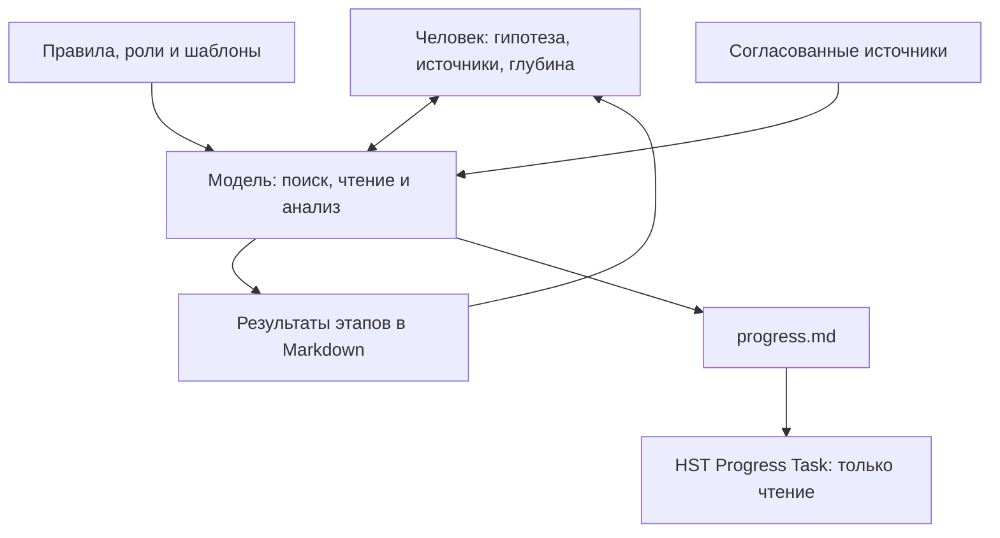

# Архитектура Markdown-прогона

Модель ведёт разбор по инструкциям и сохраняет результаты. Просмотр читает только выбранный прогон и не управляет его выполнением.

Этапы и результаты: [обзор](overview.md). Кто создаёт и читает документы: [жизненный цикл](artifact-lifecycle.md).
